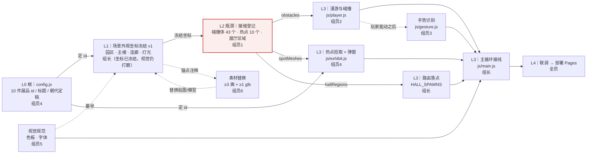

# 云墨美术馆 · 任务思维导图（一页看懂谁做什么、谁等谁）

> 拿到项目先看这一页。详细版见 [任务依赖图.md](./任务依赖图.md)，分工见 [7人分工文档.md](./7人分工文档.md)。

---

## 一、依赖链（先看这张）

---

## 二、每人第一步（今天就做，别的先别碰）

| 成员 | 负责 | 第一步 | 等谁 | 卡住谁 |
|---|---|---|---|---|
| 组长 | `js/main.js` · `src/` · 场景外观 | 坐标 v1 已冻结 → 继续打磨视觉细节 + 做主循环接线与路由落点 | 等全员 `init` 就绪 | 不卡人，但最后卡联调 |
| 组员1 | `js/scene.js`（接缝） | 读 `player.js`，先列全部碰撞体的目标坐标表 | 外观坐标（**已就绪，不用等**） | **卡住组员2、组员4、组长路由** |
| 组员2 | `js/player.js` | 跑通「前庭 → 一楼 → 连廊」，记录卡住的位置 | 等组员1 的碰撞体登记 | 卡住组员3 的手势手感 |
| 组员3 | `js/gesture.js` | 摄像头 + MediaPipe 先跑通（不管准不准） | 等组员2 让玩家能动 | 不卡别人（并行支线） |
| 组员4 | `js/config.js` · `js/exhibit.js` | 10 件展品的 id / 标题 / 朝代定稿 | 无（**全组的根，最优先**） | **卡住热点、弹窗、收藏评论** |
| 组员5 | `css/` · `js/ui.js` · `src/views` | 出色板与字体规范（场景材质要用同一套） | 无 | 不卡人，但晚了配色对不上 |
| 组员6 | `assets/` | 找齐 ≥3 幅名画 + ≥1 件 glb 模型 | 等组长外观锚点注释（已留好） | 不卡别人（并行支线） |

---

## 三、链的四段（按顺序做，不要跳段）

1. **根**：`config.js` 定「有什么」—— 10 件展品的 `id`、标题、朝代。**组员4，最先冻结。**
2. **外观**：`scene.js` 定「长什么样、键在哪」—— 园区、主楼、连廊、灯光、挂画位置。**组长，坐标 v1 已冻结；视觉细节仍在打磨（不改坐标）。**
3. **接缝**：`scene.js` 定「在哪挡、在哪触发」—— 碰撞体 43 个、热点 10 个、展厅区域 3 个。**组员1，当前瓶颈。**
4. **跑起来**：player 能走 → exhibit 能弹窗 → gesture 能操控 → `main.js` 把所有人接起来。**组员2/3/4 + 组长。**

最后一步：**联调 → 部署 GitHub Pages**，全员。

---

## 四、一句话记住

> **根在 `config.js`，扣在 `scene.js`，出口在 `main.js`。**
>
> 现在最该做的是两件事：组员4 **冻结展品 id**，组员1 **开始接缝登记**（外观坐标已经给了）。

---

## 五、四个冻结点（冻结后只改视觉，不改结构）

| 冻结 | 内容 | 时间 | 违约后果 |
|---|---|---|---|
| F1 | 展品清单与 `id` | 第 1 周末 | 挂画、热点、收藏全部返工 |
| F2 | 场景外观坐标（v1 已就绪） | 第 1 周末 | 接缝登记作废 |
| F3 | 接缝登记（碰撞/热点/展厅区域） | 第 2 周中 | player、exhibit、路由返工 |
| F4 | 各模块对外 API 签名 | 第 2 周末 | `main.js` 接线与 Vue 壳返工 |
